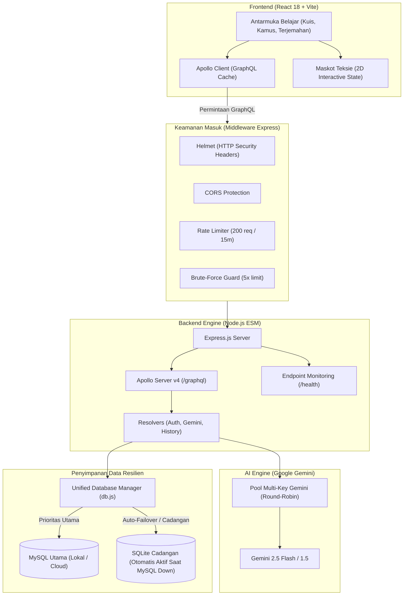

# Arsitektur Sistem PahamTeks

Dokumen ini adalah cetak biru teknis sistem **PahamTeks**. Ditulis untuk para engineer dan developer di tim agar memahami bagaimana komponen-komponen di aplikasi ini saling terhubung, dari antarmuka React sampai lapisan database ganda.

---

## 1. Gambaran Aliran Sistem (System Flow)

---

## 2. Frontend: Ringan, Cepat, Tanpa Framework CSS Kembung

Di sisi client, kita sengaja tidak menggunakan library UI berat (seperti MUI atau Bootstrap) agar bundle size tetap kecil dan kontrol styling 100% di tangan kita:

1. **React 18 & Vite**:
   - Build secepat kilat dengan Vite bundler.
   - Output produksi terkompresi secara optimal sehingga aplikasi terbuka instan di browser ponsel.
2. **Apollo Client**:
   - Menghubungkan komponen React dengan backend lewat GraphQL queries dan mutations.
   - Menggunakan in-memory caching untuk mengurangi request berulang.
3. **CSS Murni & Design Tokens**:
   - Seluruh styling diatur di [`client/src/styles/index.css`](file:///c:/Salim/Kerjaan/pahamteks/client/src/styles/index.css) menggunakan CSS Custom Properties (`--bg-dark`, `--btn-cyan`, `--btn-green`).
   - Tampilan mengusung tema gelap modern (*Cyberpunk Glassmorphism*) dengan *backdrop blur*.
4. **Utilitas Bersama**:
   - Audio dan pembacaan teks dipusatkan di [`client/src/utils/speechUtils.js`](file:///c:/Salim/Kerjaan/pahamteks/client/src/utils/speechUtils.js).
   - Logika normalisasi opsi kuis dipusatkan di [`client/src/utils/quizUtils.js`](file:///c:/Salim/Kerjaan/pahamteks/client/src/utils/quizUtils.js).

---

## 3. Backend: GraphQL + REST Monitoring

Backend kita bangun dengan **Node.js (ES Modules)**:

1. **Apollo Server v4 (`POST /graphql`)**:
   - Skema terpusat di `server/src/schema/typeDefs.js`.
   - Resolvers dibagi per domain tanggung jawab:
     - `authResolvers.js`: Registrasi, login, reset password, OTP email.
     - `geminiResolvers.js`: Pembuatan soal kuis dinamis, evaluasi "Kenapa Salah?", kamus AI, dan terjemahan suara.
     - `historyResolvers.js`: Pencatatan log aktivitas dan skor kuis pemelajar.
2. **Monitoring Endpoint (`GET /health`)**:
   - Endpoint REST yang mengecek kesehatan sistem: status database utama, status database cadangan, jumlah API key Gemini yang aktif, pemakaian RAM, dan uptime server.
   - Siap dipantau oleh UptimeRobot atau BetterStack.

---

## 4. Kenapa Kita Pakai Dua Database? (Dual Database Strategy)

Salah satu masalah paling umum saat aplikasi web dikembangkan adalah: *bagaimana kalau database MySQL lokal belum dinyalakan, passwordnya salah, atau servernya mendadak mati?*

Alih-alih membiarkan backend crash dan menampilkan error ke pengguna, kita membangun sistem **Dual Database Auto-Failover** di `server/src/config/db.js`:

1. **Kondisi Normal (MySQL Aktif)**:
   - Backend membaca dan menulis ke MySQL utama.
   - Setiap ada perubahan data baru (`INSERT`, `UPDATE`), data juga direplikasi ke SQLite lokal di background.
2. **Kondisi Darurat (MySQL Offline/Down)**:
   - Sistem langsung mengalihkan semua query ke SQLite (`node:sqlite` bawaan Node.js).
   - Pengguna tetap bisa login, mengerjakan kuis, dan menyimpan progres tanpa menyadari ada masalah di server MySQL.
   - Saat MySQL menyala kembali, sistem siap kembali ke mode utama.

---

## 5. Rotasi Kunci AI (Gemini Round-Robin)

Untuk mencegah kuota gratisan Google Gemini habis di tengah jalan saat banyak pemelajar mengakses kuis bersamaan:
- Sistem mendukung multi-key: `GEMINI_API_KEY`, `GEMINI_API_KEY_1`, `GEMINI_API_KEY_2`, dst.
- Backend memutar pemakaian kunci secara bergantian (*Round-Robin*).
- Jika ada satu kunci yang terkena limit (HTTP 429), sistem otomatis melompati kunci tersebut dan mengambil kunci berikutnya di dalam pool.

---

## 6. Standar Keamanan Sistem

- **Helmet**: Mengamankan header HTTP terhadap clickjacking, MIME sniffing, dan XSS.
- **CORS Whitelist**: Membatasi akses API hanya untuk domain frontend yang sah (`localhost`, `127.0.0.1`, dan domain `*.vercel.app`).
- **Global Rate Limiter**: Maksimal 200 request per 15 menit per alamat IP untuk mencegah penyerangan DoS.
- **Anti-Brute Force**: Jika terjadi kegagalan login berturut-turut hingga 5 kali pada email/username yang sama, akun/IP tersebut dibekukan selama 15 menit.
- **Anti-Email Bombing**: Permintaan OTP registrasi dan reset kata sandi dibatasi maksimal 3 kali per 10 menit untuk menjaga kuota SMTP dan menghindari spam.
