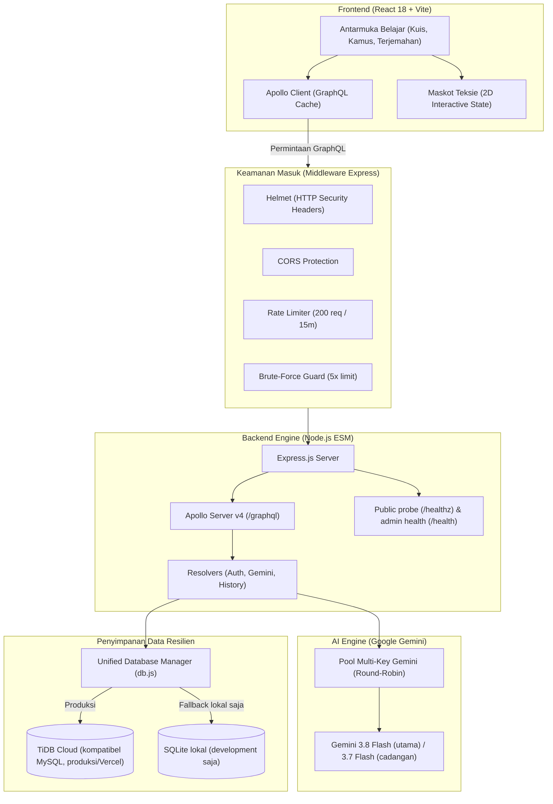

# Arsitektur Sistem PahamTeks

Dokumen ini adalah cetak biru teknis sistem **PahamTeks**. Dokumen menjelaskan hubungan React, API serverless Vercel, Gemini, TiDB Cloud, dan SQLite lokal untuk development.

---

## 1. Gambaran Aliran Sistem (System Flow)



---

## 2. Frontend: Ringan, Cepat, Tanpa Framework CSS Kembung

Di sisi client, kita sengaja tidak menggunakan library UI berat (seperti MUI atau Bootstrap) agar bundle size tetap kecil dan kontrol styling 100% di tangan kita:

1. **React 18 & Vite**:
   - Build secepat kilat dengan Vite bundler.
   - Output produksi terkompresi secara optimal sehingga aplikasi terbuka instan di browser ponsel.
2. **Apollo Client**:
   - Menghubungkan komponen React dengan backend lewat GraphQL queries dan mutations.
   - Menggunakan in-memory caching untuk mengurangi request berulang.
3. **CSS Murni & Design Tokens**:
   - Seluruh styling diatur di [`client/src/styles/index.css`](file:///c:/Salim/Kerjaan/pahamteks/client/src/styles/index.css) menggunakan CSS Custom Properties (`--bg-dark`, `--btn-cyan`, `--btn-green`).
   - Tampilan mengusung tema gelap modern (*Cyberpunk Glassmorphism*) dengan *backdrop blur*.
4. **Utilitas Bersama**:
   - Audio dan pembacaan teks dipusatkan di [`client/src/utils/speechUtils.js`](file:///c:/Salim/Kerjaan/pahamteks/client/src/utils/speechUtils.js).
   - Logika normalisasi opsi kuis dipusatkan di [`client/src/utils/quizUtils.js`](file:///c:/Salim/Kerjaan/pahamteks/client/src/utils/quizUtils.js).

---

## 3. Backend: GraphQL + REST Monitoring

Backend kita bangun dengan **Node.js (ES Modules)**:

1. **Apollo Server v4 (`POST /graphql`)**:
   - Skema terpusat di `server/src/schema/typeDefs.js`.
   - Resolvers dibagi per domain tanggung jawab:
     - `authResolvers.js`: Registrasi, login, reset password, OTP email.
     - `geminiResolvers.js`: Pembuatan soal kuis dinamis, evaluasi "Kenapa Salah?", kamus AI, dan terjemahan suara.
     - `historyResolvers.js`: Pencatatan log aktivitas dan skor kuis pemelajar.
2. **Monitoring Endpoint (`GET /healthz`)**:
   - Endpoint publik ringan yang mengembalikan HTTP 200 dan `{ "status": "OK" }` untuk liveness check UptimeRobot.
   - `GET /health` menampilkan telemetri internal dan memerlukan token admin; jangan daftarkan endpoint ini sebagai monitor publik.

---

## 4. Database Berdasarkan Lingkungan

TiDB Cloud menjadi penyimpanan persisten untuk produksi dan kompatibel dengan driver `mysql2`. Integrasi Vercel dapat mengisi `TIDB_HOST`, `TIDB_PORT`, `TIDB_USER`, `TIDB_PASSWORD`, dan `TIDB_DATABASE`; `server/src/config/db.js` menerima nama-nama itu langsung serta tetap mendukung `DB_*`. Saat memakai `TIDB_HOST`, koneksi TLS diaktifkan otomatis kecuali `DB_SSL=false`. Pada Vercel, koneksi dibuka secara lazy saat ada request dan skema tabel disiapkan ketika koneksi berhasil.

SQLite hanya dipakai sebagai fallback development lokal. Filesystem fungsi Vercel, termasuk `/tmp`, bersifat sementara dan tidak boleh dipakai untuk menyimpan akun atau progres. Jika TiDB belum dikonfigurasi atau tidak dapat dihubungi, operasi penyimpanan di produksi gagal; backend tidak menganggap data memori sebagai data tersimpan.

## 5. Rencana Arsitektur Materi dari Dokumen Pengguna

Fitur ini belum diimplementasikan. Alur yang direncanakan:

```text
Pengguna memilih file/folder
        → validasi akses, tipe, ukuran, dan keamanan
        → simpan file ke object storage persisten
        → ekstrak teks dan pecah menjadi potongan berindeks
        → simpan metadata/izin/status di TiDB
        → cari potongan relevan saat sesi belajar
        → kirim konteks terbatas ke Gemini
        → jawab dengan rujukan dokumen/halaman
```

Jangan menyimpan file upload di disk fungsi Vercel. TiDB menyimpan metadata dan relasi kepemilikan; file asli memerlukan object storage persisten yang dipilih tim, dan pencarian semantik memerlukan evaluasi opsi indeks sebelum diputuskan. Setiap query retrieval wajib memfilter berdasarkan pengguna/kelas yang berwenang. Perlakukan isi dokumen sebagai konten tak tepercaya, bukan instruksi sistem. Jawaban harus merujuk dokumen dan bagian/halaman yang tersedia, serta menyatakan jika informasi tidak ditemukan.

---

## 6. Rotasi Kunci AI (Gemini Round-Robin)

Untuk mencegah kuota gratisan Google Gemini habis di tengah jalan saat banyak pemelajar mengakses kuis bersamaan:
- Sistem mendukung multi-key: `GEMINI_API_KEY`, `GEMINI_API_KEY_1`, `GEMINI_API_KEY_2`, dst.
- Backend memutar pemakaian kunci secara bergantian (*Round-Robin*).
- Jika ada satu kunci yang terkena limit (HTTP 429), sistem otomatis melompati kunci tersebut dan mengambil kunci berikutnya di dalam pool.

---

## 7. Standar Keamanan Sistem

- **Helmet**: Mengamankan header HTTP terhadap clickjacking, MIME sniffing, dan XSS.
- **CORS Whitelist**: Membatasi akses API ke origin lokal, daftar `ALLOWED_ORIGINS`, dan Cloudflare Tunnel saat digunakan.
- **Global Rate Limiter**: Maksimal 200 request per 15 menit per alamat IP untuk mencegah penyerangan DoS.
- **Anti-Brute Force**: Jika terjadi kegagalan login berturut-turut hingga 5 kali pada email/username yang sama, akun/IP tersebut dibekukan selama 15 menit.
- **Anti-Email Bombing**: Permintaan OTP registrasi dan reset kata sandi dibatasi maksimal 3 kali per 10 menit untuk menjaga kuota SMTP dan menghindari spam.
