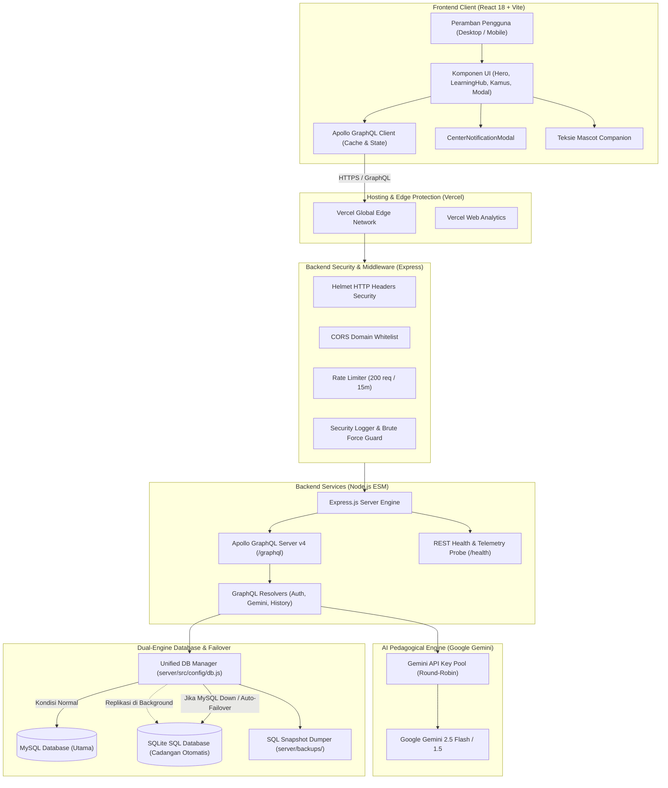

# Arsitektur Sistem PahamTeks (ARCHITECTURE.md)

Dokumen ini menjelaskan rancangan arsitektur teknologi, aliran data, komponen keamanan, dan strategi *high-availability* sistem **PahamTeks**.

---

## 1. Diagram Arsitektur Tingkat Tinggi



---

## 2. Lapisan Frontend (Client Layer)

* **Framework**: React 18.3 didukung oleh bundler **Vite 6** (*lightning-fast hot reload* dan *minified production builds*).
* **Data Fetching**: `@apollo/client` untuk melakukan komunikasi data deklaratif (Queries & Mutations) dengan Apollo Server.
* **Gaya & Desain Visual**:
  * Sistem *Design Token* CSS kustom murni ([`client/src/styles/index.css`](file:///c:/Salim/Kerjaan/pahamteks/client/src/styles/index.css)) dengan tema *Dark Cyberpunk Glassmorphism*.
  * Efek *Backdrop Filter Blur* untuk modal dan tombol mengambang.
  * Komponen notifikasi kustom [`CenterNotificationModal.jsx`](file:///c:/Salim/Kerjaan/pahamteks/client/src/components/CenterNotificationModal.jsx) untuk menggantikan pop-up bawaan browser yang kaku.
  * Pustaka ikon: `lucide-react` dan ikon seni 2D kustom [`Art2DIcons.jsx`](file:///c:/Salim/Kerjaan/pahamteks/client/src/components/Art2DIcons.jsx).
  * Pustaka utilitas: `jquery` (^4.0.0).

---

## 3. Lapisan Backend & API (Server Layer)

* **Runtime**: Node.js v18+ / v24 dengan arsitektur *ECMAScript Modules (ESM)* murni (`"type": "module"`).
* **Server Web**: Express.js 4.21.
* **API Endpoints**:
  1. **GraphQL API (`POST /graphql`)**: Titik temu utama untuk kuis, autentikasi, kamus, progres belajar, dan terjemahan.
  2. **Health Check (`GET /health`)**: Endpoint REST untuk telemetri sistem, uptime, status database utama & cadangan, pemakaian RAM, dan status API keys.

---

## 4. Lapisan Keamanan (Security Hardening)

Sistem PahamTeks dilengkapi dengan proteksi berlapis:
1. **HTTP Headers (`helmet`)**: Menyuntikkan header keamanan untuk mencegah XSS, Clickjacking, dan MIME-sniffing.
2. **CORS Whitelist**: Membatasi origin yang diizinkan hanya pada domain Vercel (`pahamteks.vercel.app`, `*.vercel.app`) dan `localhost` saat development.
3. **Pembatas Laju (*Rate Limiting*)**: Membatasi maksimal 200 request per 15 menit per IP untuk mencegah serangan *Denial of Service (DoS)* dan pembajakan bot scraper.
4. **Brute Force Guard ([`server/src/utils/securityLogger.js`](file:///c:/Salim/Kerjaan/pahamteks/server/src/utils/securityLogger.js))**:
   * Memantau upaya login gagal.
   * Jika terjadi 5 kali kegagalan berturut-turut pada akun/IP yang sama, akun dikunci otomatis selama 15 menit.
5. **Anti-Email Bombing OTP**: Membatasi permintaan OTP maksimal 3 kali per 10 menit untuk mencegah penyalahgunaan kuota email SMTP.
6. **Autentikasi Bertanda Tangan JWT (`jsonwebtoken`)**: Mengeluarkan token sesi dengan masa berlaku 7 hari yang tahan pemalsuan.

---

## 5. Integrasi AI & Pengelolaan Kunci (AI Layer)

* **Penyedia AI**: Google Gemini API via SDK `@google/genai`.
* **Mekanisme Round-Robin Key Pool ([`server/src/config/gemini.js`](file:///c:/Salim/Kerjaan/pahamteks/server/src/config/gemini.js))**:
  * Mendukung pendaftaran banyak kunci API sekaligus (`GEMINI_API_KEY`, `GEMINI_API_KEY_1`, ..., `GEMINI_API_KEY_9`).
  * Sistem memutar kunci secara bergantian untuk setiap request, sehingga beban kuota terdistribusi dan kebal terhadap *rate-limit* kuota gratis Google.

---

## 6. Arsitektur Basis Data & Auto-Failover (Database Layer)

PahamTeks menerapkan prinsip **Dual-Persistence & Zero-Downtime SQL**:

```
+-------------------------------------------------------+
|              Unified Database Manager                 |
|             (server/src/config/db.js)                 |
+-------------------------------------------------------+
                           |
            +--------------+--------------+
            |                             |
      (MySQL Normal)               (MySQL Gagal/Down)
            v                             v
+-----------------------+     +-----------------------+
|  Primary MySQL Pool   |     | Fallback SQLite Engine|
|  (pahamteks_db)       |     | (pahamteks_backup.db) |
+-----------------------+     +-----------------------+
            |                             ^
            | (Replikasi Background)      |
            +-----------------------------+
```

1. **MySQL (Database Utama)**: Menggunakan driver `mysql2/promise` dengan *connection pool* untuk performa tinggi pada lingkungan produksi.
2. **SQLite (Database Cadangan Otomatis)**:
   * Menggunakan modul SQL bawaan Node.js (`node:sqlite`).
   * Tersimpan persisten di berkas [`server/data/pahamteks_backup.sqlite`](file:///c:/Salim/Kerjaan/pahamteks/server/data/pahamteks_backup.sqlite).
   * Otomatis mengambil alih query jika MySQL offline, memastikan pengguna tetap dapat login, mendaftar, dan menyimpan progres.
3. **Pencadangan Snapshot SQL ([`server/src/db/exportSqlBackup.js`](file:///c:/Salim/Kerjaan/pahamteks/server/src/db/exportSqlBackup.js))**:
   * Skrip otomatis untuk mengekspor seluruh data aktif ke berkas `.sql` kapan saja via perintah `npm --prefix server run backup-db`.
