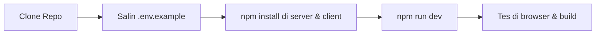

# Alur Kerja & SOP Tim (WORKFLOW.md)

Dokumen ini adalah panduan kerja harian (*Standard Operating Procedure*) untuk developer dan kontributor di PahamTeks: dari cara setup lokal, aturan main Git, backup database, sampai langkah yang harus diambil kalau ada masalah di server.

---

## 1. Alur Ngoding di Laptop Lokal



### Langkah Cepat:
1. **Pasang Dependencies**:
   ```bash
   npm --prefix server install
   npm --prefix client install
   ```
2. **Setup File Environment**:
   Salin `server/.env.example` ke `server/.env` untuk pengembangan lokal, lalu isi variabel yang dibutuhkan. Jangan menyalin rahasia produksi ke template atau Git.
3. **Inisialisasi Database (Opsional)**:
   ```bash
   npm --prefix server run init-db
   ```
   *Catatan: SQLite fallback hanya untuk development lokal. Hosting produksi menggunakan Vercel dan TiDB Cloud persisten; filesystem fungsi Vercel tidak boleh dipakai menyimpan akun/progres.*
4. **Jalankan Aplikasi**:
   * Terminal 1 (Backend): `npm --prefix server run dev` (port 4000)
   * Terminal 2 (Frontend): `npm --prefix client run dev` (port 3000)

---

## 2. Aturan Wajib Git & Push ke GitHub

Setiap kali kamu (atau AI asistenmu) selesai membuat fitur baru atau memperbaiki bug, jalankan urutan ini:

```
1. Verifikasi Build Frontend
   npm --prefix client run build
   (Wajib lulus 100%! Jangan pernah push jika build masih merah/gagal)
               │
               ▼
2. Cek Berkas yang Berubah
   git status
   (Pastikan TIDAK ADA file .env atau file database yang ikut terbawa)
               │
               ▼
3. Stage & Commit
   git add <nama-berkas>
   git commit -m "feat/fix: penjelasan perubahan yang manusiawi"
               │
               ▼
4. Push Langsung
   git push origin main
               │
               ▼
5. Deployment Vercel
   Setelah commit dan push ke branch yang terhubung, periksa deployment di Vercel. Cloudflare Tunnel hanya untuk demo lokal sementara.
```

### 🛑 Pantangan Keras (Zero Leak Policy):
* **JANGAN PERNAH** menambahkan atau mem-push berkas `.env`, `server/.env`, atau `client/.env.local`.
* **JANGAN PERNAH** mem-push database lokal (`server/data/*.sqlite`) atau file dump database yang berisi data nyata pengguna.

---

## 3. Cara Backup Data Manual

Kapan pun kamu ingin membuat cadangan data utuh (akun, riwayat kuis, kamus, log) ke dalam file SQL:
```bash
npm --prefix server run backup-db
```
* File cadangan akan disimpan di folder [`server/backups/`](file:///c:/Salim/Kerjaan/pahamteks/server/backups/) dengan nama `pahamteks_backup_YYYY-MM-DD_HH-mm-ss.sql`.
* File SQL ini bisa di-restore ke MySQL server mana pun dengan perintah:
  ```bash
  mysql -u root -p pahamteks_db < server/backups/pahamteks_backup_*.sql
  ```

---

## 4. Langkah Darurat Kalau Terjadi Masalah (Incident Response)

Jika tiba-tiba web lambat, ada laporan kuis gagal dimuat, atau server down:

1. **Periksa UptimeRobot dan endpoint liveness**:
   Pastikan monitor mengarah ke `https://<domain-produksi>/healthz`. Endpoint ini publik dan mengembalikan status proses/rute, bukan status database.
2. **Periksa Status Komponen**:
   * **Jika TiDB tidak tersambung**:
     Periksa `TIDB_HOST`, `TIDB_PORT`, `TIDB_USER`, `TIDB_PASSWORD`, dan `TIDB_DATABASE` di Vercel Project Settings → Environment Variables. Backend juga menerima `DB_HOST`, `DB_PORT`, `DB_USER`, `DB_PASSWORD`, dan `DB_NAME` untuk konfigurasi manual. Pastikan cluster aktif dan redeploy setelah perubahan.
   * **Jika kuota Gemini limit (429)**:
     Cek `geminiKeysRegistered`. Tambahkan satu API key gratis cadangan di `server/.env` (`GEMINI_API_KEY_2=...`).
   * **Jika fungsi error**:
     Periksa Vercel → Project → Logs. Fungsi Vercel berjalan per invocation; jangan gunakan metrik RAM invocation sebagai pemantauan server permanen.

## 5. Rencana fitur materi dari folder dokumen

Upload materi belum tersedia di aplikasi. Sebelum dikembangkan, sepakati format dan batas file, pemeriksaan keamanan, penyimpanan file di object storage persisten, akses per pengguna/kelas, kebijakan retensi/penghapusan, serta cara AI mengambil potongan sumber dan menampilkan rujukan. Jangan menyimpan upload di filesystem fungsi Vercel atau mengikuti instruksi yang tertanam di dokumen. Detail rancangan ada di `PRD.md` dan `ARCHITECTURE.md`.
