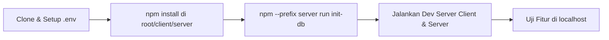
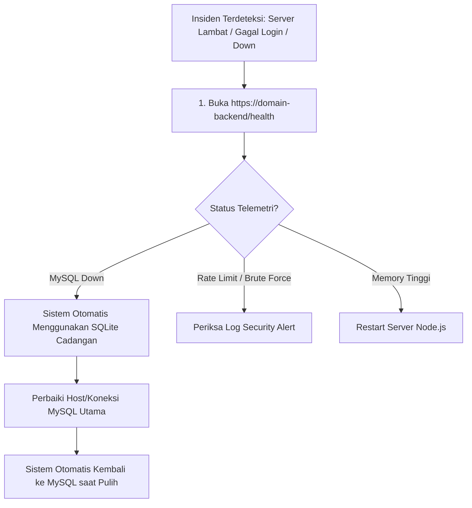

# Prosedur Operasional & Alur Kerja (WORKFLOW.md)

Dokumen ini berisi panduan alur kerja (*workflows*) pengembangan, pengujian, pencadangan basis data, integrasi berkelanjutan (*CI/CD*), dan penanganan insiden operasional di **PahamTeks**.

---

## 1. Alur Kerja Pengembangan Lokal (Local Development)



### Langkah-langkah:
1. **Pemasangan Dependensi**:
   ```bash
   # Pasang dependensi di server dan client
   npm --prefix server install
   npm --prefix client install
   ```
2. **Konfigurasi Environment**:
   Salin file template [`.env.example`](file:///c:/Salim/Kerjaan/pahamteks/.env.example) ke `server/.env` dan isi kunci API Gemini serta kredensial MySQL.
3. **Inisialisasi Database**:
   ```bash
   npm --prefix server run init-db
   ```
   *(Catatan: Jika MySQL lokal belum menyala, sistem akan otomatis beralih menggunakan Database Cadangan SQLite secara transparan).*
4. **Menjalankan Server Lokal**:
   * Terminal 1 (Backend): `npm --prefix server run dev` (berjalan di port `4000`)
   * Terminal 2 (Frontend): `npm --prefix client run dev` (berjalan di port `5173`)

---

## 2. Alur Otomatisasi Git & Deployment (CI/CD Pipeline)

Sesuai aturan operasional [`GEMINI.md`](file:///c:/Salim/Kerjaan/pahamteks/GEMINI.md), setiap perubahan kode wajib melalui alur otomatisasi berikut:

```
[Modifikasi Kode / Fitur Baru]
              |
              v
[1. Verifikasi Build Frontend]  ---> (npm --prefix client run build)
              |
       (Jika Sukses)
              v
[2. Staging Berkas Aman]        ---> (git add <file-aman>)
              |
              v
[3. Commit Deskriptif]          ---> (git commit -m "feat/fix: ...")
              |
              v
[4. Push ke GitHub Main]        ---> (git push origin main)
              |
              v
[5. Auto-Deploy Vercel]         ---> (Vercel otomatis build & live)
```

### 🛑 Aturan Keamanan Staging (Zero Leak Policy):
Sebelum menjalankan `git add`, pastikan:
* File kredensial (`server/.env`, `client/.env.local`, `.env`) **TIDAK PERNAH DI-STAGE**.
* File database lokal (`server/data/*.sqlite`) dan dump SQL (`server/backups/*.sql`) **TIDAK BOLEH IKUT DI-STAGE**.
* Selalu verifikasi status dengan:
  ```bash
  git status
  ```

---

## 3. Alur Pencadangan Basis Data (Backup & Recovery Workflow)

### 3.1 Membuat Snapshot SQL Kapan Saja
Untuk mencadangkan seluruh data aktif (akun pengguna, OTP, riwayat kuis, kamus, log aktivitas) menjadi berkas SQL snapshot:
```bash
npm --prefix server run backup-db
```
* **Hasil Berkas**: Tersimpan di folder [`server/backups/`](file:///c:/Salim/Kerjaan/pahamteks/server/backups/) dengan format nama: `pahamteks_backup_YYYY-MM-DD_HH-mm-ss.sql`.
* **Karakteristik**: Berkas snapshot ini dapat diimpor kembali ke server MySQL baru kapan saja menggunakan perintah standar:
  ```bash
  mysql -u root -p pahamteks_db < server/backups/pahamteks_backup_*.sql
  ```

---

## 4. Alur Penanganan Insiden (Incident Response Workflow)



### Langkah Pemeriksaan Insiden:
1. **Cek Kesehatan Sistem Melalui Peramban / Uptime Monitor**:
   Buka URL `https://<domain-backend>/health`.
   * Periksa field `"database"`. Jika `"primary": "MYSQL_OFFLINE"` dan `"activeEngine": "SQLite (Cadangan Otomatis)"`, berarti server utama sedang down, namun sistem tetap aman berkat database cadangan SQL.
2. **Cek Upaya Peretasan di Konsol Server**:
   Cari baris log bertanda:
   * `🚨 [SECURITY ALERT] BRUTE_FORCE_TRIGGERED`: Indikasi ada bot yang mencoba menebak kata sandi pengguna secara beruntun.
   * `⚠️ [SECURITY WARN] OTP_RATE_LIMIT_EXCEEDED`: Indikasi ada pihak yang mencoba membombardir pengiriman email OTP.
3. **Pemulihan MySQL Utama**:
   Setelah server MySQL utama normal kembali, restart server backend. Unified DB Manager akan otomatis mendeteksi koneksi MySQL dan kembali menggunakannya sebagai database primer.

